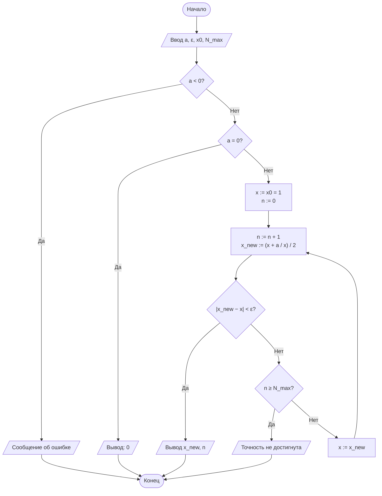
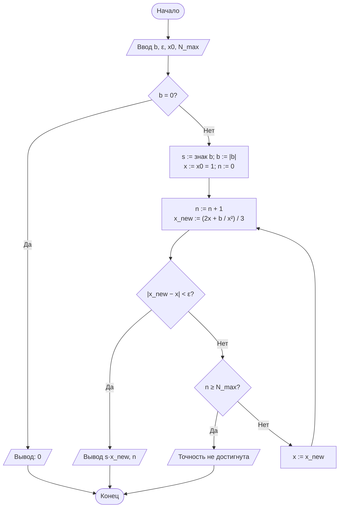
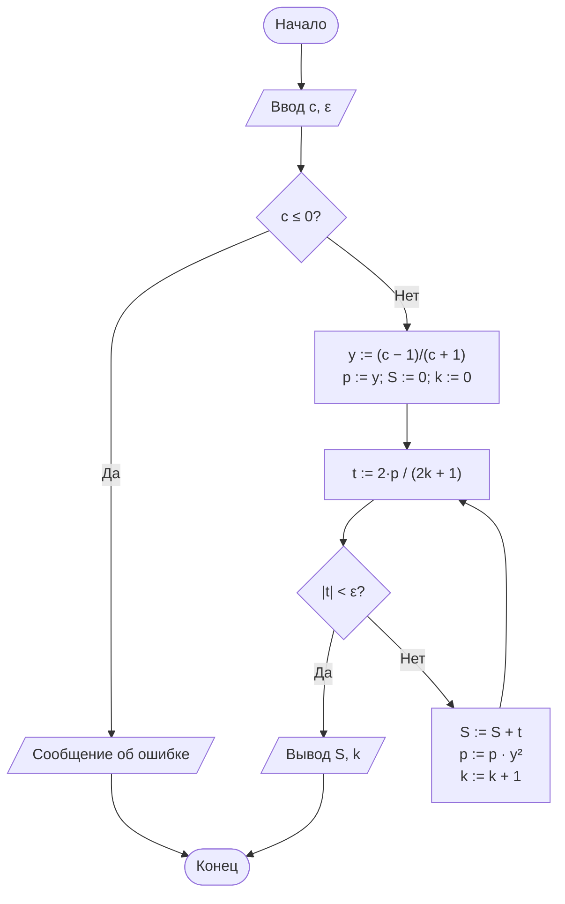
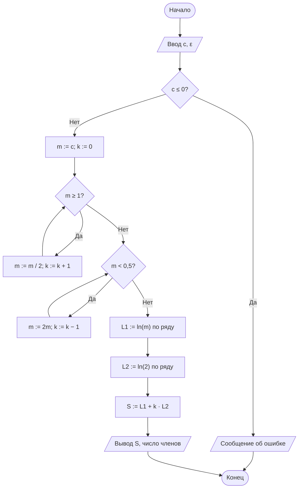

# Лабораторная работа № 1. Вариант 11

## Итерационные методы вычисления элементарных функций: квадратный корень, кубический корень и натуральный логарифм

**Дисциплина:** Теория алгоритмов
**Направление подготовки:** 38.03.05 «Бизнес-информатика»
**Выполнил:** Колесный Степан, группа БИ2-1

Файлы в репозитории:

| Файл | Назначение |
|---|---|
| [`lab1_variant11.py`](lab1_variant11.py) | Программа (Python 3.10+) |
| [`LR1_Kolesny_BI2-1_variant11.pdf`](LR1_Kolesny_BI2-1_variant11.pdf) | Отчёт с титульным листом |
| `README.md` | Этот файл |

Запуск: `python lab1_variant11.py` (сторонние библиотеки не нужны).

---

## 1. Цель и задание

**Цель работы:** сформировать представление об итерационных алгоритмах как о процедурах последовательного уточнения приближений, освоить оценку их сходимости и трудоёмкости.

**Задание варианта 11:** вычислить $\sqrt{29}$, $\sqrt[3]{70}$ и $\ln 50$ с точностью $\varepsilon = 10^{-4}$.

| $a$ | $b$ | $c$ | $\varepsilon$ | Критерий | $x_0$ | Доп. |
|---|---|---|---|---|---|---|
| 29 | 70 | 50 | $10^{-4}$ | Р (по разности) | $x_0 = 1$ | Д3 |

**Д3:** реализовать вычисление $\ln c$ с нормализацией аргумента ($c = m \cdot 2^k$) и сравнить число итераций с ненормализованным вариантом.

## 2. Теория (кратко)

- Метод Ньютона: $x_{n+1} = x_n - \dfrac{F(x_n)}{F'(x_n)}$, сходимость квадратичная.
- Квадратный корень ($F = x^2 - a$), формула Герона: $x_{n+1} = \dfrac12\left(x_n + \dfrac{a}{x_n}\right)$.
- Кубический корень ($F = x^3 - b$): $x_{n+1} = \dfrac13\left(2x_n + \dfrac{b}{x_n^2}\right)$; для $b<0$ используется $\sqrt[3]{b} = -\sqrt[3]{|b|}$.
- Логарифм: $\ln c = 2\left(y + \dfrac{y^3}{3} + \dfrac{y^5}{5} + \ldots\right)$, $y = \dfrac{c-1}{c+1}$. При $c \gg 1$ значение $|y|$ близко к 1, сходимость медленная.
- Нормализация (Д3): $c = m \cdot 2^k$, $m \in [0{,}5;\,1)$, $\ln c = \ln m + k \ln 2$. Здесь $|y| \le 1/3$, ряд сходится быстро.
- Критерий остановки: $|x_{n+1} - x_n| < \varepsilon$ (для ряда: $|t_k| < \varepsilon$), страховка — $N_{\max}$.

## 3. Блок-схемы

### 3.1. Квадратный корень



### 3.2. Кубический корень



### 3.3. Натуральный логарифм (без нормализации)



### 3.4. Натуральный логарифм с нормализацией (Д3)



## 4. Листинг программы

```python
"""
Лабораторная работа № 1. Вариант 11.
Итерационные методы вычисления √a, ∛b, ln c.

Автор: Колесный Степан, группа БИ2-1.

Исходные данные варианта 11:
    a = 29, b = 70, c = 50, eps = 1e-4,
    критерий остановки: Р (по разности соседних приближений),
    начальное приближение: x0 = 1,
    дополнительное требование: Д3 (нормализация аргумента логарифма).

Запуск:  python lab1_variant11.py
"""
import math

# ---------------------------------------------------------------- параметры
A, B, C = 29, 70, 50
EPS = 1e-4
X0 = 1.0
N_MAX = 100
N_MAX_LN = 10_000


# ------------------------------------------------------------ квадратный корень
def sqrt_newton(a, eps=EPS, x0=X0, n_max=N_MAX, trace=None):
    """Квадратный корень методом Ньютона (формула Герона).

    Возвращает (результат, число итераций).
    Если передан список trace, в него добавляются кортежи (n, x_n, |x_n - x_{n-1}|).
    """
    if a < 0:
        raise ValueError("Подкоренное выражение должно быть неотрицательным")
    if a == 0:
        return 0.0, 0
    x = float(x0)
    for n in range(1, n_max + 1):
        x_new = 0.5 * (x + a / x)
        if trace is not None:
            trace.append((n, x_new, abs(x_new - x)))
        if abs(x_new - x) < eps:          # критерий Р
            return x_new, n
        x = x_new
    raise RuntimeError("Точность не достигнута за N_MAX итераций")


# ------------------------------------------------------------ кубический корень
def cbrt_newton(b, eps=EPS, x0=X0, n_max=N_MAX, trace=None):
    """Кубический корень методом Ньютона (с учётом знака аргумента)."""
    if b == 0:
        return 0.0, 0
    sign = -1 if b < 0 else 1
    b = abs(b)                            # метод применяется к модулю
    x = float(x0)
    for n in range(1, n_max + 1):
        x_new = (2 * x + b / (x * x)) / 3
        if trace is not None:
            trace.append((n, sign * x_new, abs(x_new - x)))
        if abs(x_new - x) < eps:          # критерий Р
            return sign * x_new, n
        x = x_new
    raise RuntimeError("Точность не достигнута за N_MAX итераций")


# ------------------------------------------------- натуральный логарифм (ряд)
def ln_series(c, eps=EPS, n_max=N_MAX_LN):
    """ln c = 2 (y + y^3/3 + y^5/5 + ...), y = (c - 1)/(c + 1).

    Без нормализации аргумента. Возвращает (результат, число членов ряда).
    """
    if c <= 0:
        raise ValueError("Аргумент логарифма должен быть положительным")
    y = (c - 1) / (c + 1)
    y2 = y * y
    power = y                              # текущая степень y^(2k+1)
    total = 0.0
    for k in range(n_max):
        term = 2 * power / (2 * k + 1)
        if abs(term) < eps:
            return total, k
        total += term
        power *= y2
    raise RuntimeError("Точность не достигнута за n_max итераций")


# ------------------------------------- Д3: логарифм с нормализацией аргумента
def normalize(c):
    """Представляет c = m * 2^k, m in [0.5, 1). Возвращает (m, k).

    Используются только умножение и деление на 2 (без math.log / frexp).
    """
    if c <= 0:
        raise ValueError("Аргумент логарифма должен быть положительным")
    m, k = float(c), 0
    while m >= 1:
        m /= 2
        k += 1
    while m < 0.5:
        m *= 2
        k -= 1
    return m, k


def ln_normalized(c, eps=EPS, n_max=N_MAX_LN):
    """ln c = ln m + k ln 2, оба логарифма считаются рядом при |y| <= 1/3.

    Возвращает (результат, суммарное число членов ряда, m, k).
    """
    m, k = normalize(c)
    ln_m, n_m = ln_series(m, eps, n_max)
    if k != 0:
        ln2, n_2 = ln_series(2.0, eps, n_max)
    else:
        ln2, n_2 = 0.0, 0
    return ln_m + k * ln2, n_m + n_2, m, k


# -------------------------------------------------------------------- вывод
def table_row(name, arg, val, ref, n):
    return (f"{name:<10}{arg:>10}{val:>16.10f}{ref:>16.10f}"
            f"{abs(val - ref):>14.2e}{n:>10}")


def print_trace(title, trace, ref):
    print(f"\n{title}")
    print(f"{'n':>3}{'x_n':>18}{'|x_n - x_(n-1)|':>20}{'|x_n - эталон|':>18}")
    for n, x, d in trace:
        print(f"{n:>3}{x:>18.10f}{d:>20.3e}{abs(x - ref):>18.3e}")


def main():
    # эталонные значения (допустимо использовать math только здесь)
    ref_sqrt = math.sqrt(A)
    ref_cbrt = B ** (1 / 3)
    ref_ln = math.log(C)

    print(f"Вариант 11: a = {A}, b = {B}, c = {C}, eps = {EPS}, x0 = {X0}\n")

    v_sqrt, n_sqrt = sqrt_newton(A)
    v_cbrt, n_cbrt = cbrt_newton(B)
    v_ln, n_ln = ln_series(C)
    v_lnn, n_lnn, m, k = ln_normalized(C)

    print(f"{'Функция':<10}{'Аргумент':>10}{'Результат':>16}"
          f"{'Эталон':>16}{'Погрешность':>14}{'Итераций':>10}")
    print(table_row("sqrt", A, v_sqrt, ref_sqrt, n_sqrt))
    print(table_row("cbrt", B, v_cbrt, ref_cbrt, n_cbrt))
    print(table_row("ln", C, v_ln, ref_ln, n_ln))
    print(table_row("ln (норм.)", C, v_lnn, ref_ln, n_lnn))

    # ---- Д3: сравнение логарифма без нормализации и с нормализацией
    y_plain = (C - 1) / (C + 1)
    y_norm = (m - 1) / (m + 1)
    print("\nД3. Нормализация аргумента логарифма")
    print(f"  c = {C} = m * 2^k,  m = {m},  k = {k}")
    print(f"  Без нормализации: y = {y_plain:.6f},  членов ряда: {n_ln}")
    print(f"  С нормализацией:  y(m) = {y_norm:.6f}, y(2) = {1/3:.6f}")
    ln_m, n_m = ln_series(m)
    ln_2, n_2 = ln_series(2.0)
    print(f"    ln m   = {ln_m:.10f}  (членов: {n_m})")
    print(f"    ln 2   = {ln_2:.10f}  (членов: {n_2})")
    print(f"    ln c   = ln m + k*ln 2 = {v_lnn:.10f}")
    print(f"  Итого членов ряда: {n_lnn}; выигрыш: {n_ln / n_lnn:.2f} раза")

    # ---- таблицы итераций (для анализа сходимости)
    tr = []
    sqrt_newton(A, trace=tr)
    print_trace("Итерации для sqrt(29), x0 = 1", tr, ref_sqrt)
    tr = []
    cbrt_newton(B, trace=tr)
    print_trace("Итерации для cbrt(70), x0 = 1", tr, ref_cbrt)

    # ---- проверка условия Д3 для разных c (нормализация даёт выигрыш)
    print("\nСравнение числа членов ряда для разных c (eps = 1e-4)")
    print(f"{'c':>8}{'без норм.':>12}{'с норм.':>10}")
    for c in (2, 5, 10, 50, 100, 1000):
        _, n1 = ln_series(c)
        _, n2, _, _ = ln_normalized(c)
        print(f"{c:>8}{n1:>12}{n2:>10}")


if __name__ == "__main__":
    main()
```

## 5. Результаты

**Таблица 1. Результаты вычислений ($\varepsilon = 10^{-4}$)**

| Функция | Аргумент | Результат | Эталон (`math`) | Абс. погрешность | Число итераций |
|---|---|---|---|---|---|
| $\sqrt{a}$ | 29 | 5,3851648075 | 5,3851648071 | $3{,}88 \cdot 10^{-10}$ | 6 |
| $\sqrt[3]{b}$ | 70 | 4,1212853006 | 4,1212852998 | $7{,}86 \cdot 10^{-10}$ | 9 |
| $\ln c$ (без нормализации) | 50 | 3,9109286139 | 3,9120230054 | $1{,}09 \cdot 10^{-3}$ | 63 |
| $\ln c$ (с нормализацией) | 50 | 3,9119597610 | 3,9120230054 | $6{,}32 \cdot 10^{-5}$ | 6 |

**Таблица 2 (Д3). Нормализация: $50 = 0{,}78125 \cdot 2^6$**

| Вариант | $y$ | Слагаемое | Членов ряда |
|---|---|---|---|
| Без нормализации | $49/51 \approx 0{,}9608$ | $\ln 50$ | 63 |
| С нормализацией | $y(m) \approx -0{,}1228$ | $\ln m = -0{,}2468487830$ | 2 |
| | $y(2) = 1/3$ | $\ln 2 = 0{,}6931347573$ | 4 |
| **Итого** | | $\ln 50 = \ln m + 6\ln 2 = 3{,}9119597610$ | **6** |

Выигрыш: $63 / 6 = 10{,}5$ раза.

**Таблица 3. Число членов ряда для разных $c$ ($\varepsilon = 10^{-4}$)**

| $c$ | 2 | 5 | 10 | 50 | 100 | 1000 |
|---|---|---|---|---|---|---|
| Без нормализации | 4 | 9 | 16 | 63 | 112 | 674 |
| С нормализацией | 8 | 7 | 7 | 6 | 6 | 5 |

**Таблица 4. Итерации для $\sqrt{29}$ ($x_0 = 1$)**

| $n$ | $x_n$ | $\lvert x_n - x_{n-1}\rvert$ | $\lvert x_n - x^*\rvert$ |
|---|---|---|---|
| 1 | 15,0000000000 | $1{,}400 \cdot 10^{1}$ | $9{,}615$ |
| 2 | 8,4666666667 | $6{,}533$ | $3{,}082$ |
| 3 | 5,9459317585 | $2{,}521$ | $5{,}608 \cdot 10^{-1}$ |
| 4 | 5,4116080617 | $5{,}343 \cdot 10^{-1}$ | $2{,}644 \cdot 10^{-2}$ |
| 5 | 5,3852294132 | $2{,}638 \cdot 10^{-2}$ | $6{,}461 \cdot 10^{-5}$ |
| 6 | 5,3851648075 | $6{,}461 \cdot 10^{-5}$ | $3{,}875 \cdot 10^{-10}$ |

**Таблица 5. Итерации для $\sqrt[3]{70}$ ($x_0 = 1$)**

| $n$ | $x_n$ | $\lvert x_n - x_{n-1}\rvert$ | $\lvert x_n - x^*\rvert$ |
|---|---|---|---|
| 1 | 24,0000000000 | $2{,}300 \cdot 10^{1}$ | $19{,}88$ |
| 2 | 16,0405092593 | $7{,}959$ | $11{,}92$ |
| 3 | 10,7843588884 | $5{,}256$ | $6{,}663$ |
| 4 | 7,3901990111 | $3{,}394$ | $3{,}269$ |
| 5 | 5,3540320723 | $2{,}036$ | $1{,}233$ |
| 6 | 4,3833368034 | $9{,}707 \cdot 10^{-1}$ | $2{,}621 \cdot 10^{-1}$ |
| 7 | 4,1366394759 | $2{,}467 \cdot 10^{-1}$ | $1{,}535 \cdot 10^{-2}$ |
| 8 | 4,1213422202 | $1{,}530 \cdot 10^{-2}$ | $5{,}692 \cdot 10^{-5}$ |
| 9 | 4,1212853006 | $5{,}692 \cdot 10^{-5}$ | $7{,}861 \cdot 10^{-10}$ |

Полный вывод программы:

```text
Вариант 11: a = 29, b = 70, c = 50, eps = 0.0001, x0 = 1.0

Функция     Аргумент       Результат          Эталон   Погрешность  Итераций
sqrt              29    5.3851648075    5.3851648071      3.88e-10         6
cbrt              70    4.1212853006    4.1212852998      7.86e-10         9
ln                50    3.9109286139    3.9120230054      1.09e-03        63
ln (норм.)        50    3.9119597610    3.9120230054      6.32e-05         6

Д3. Нормализация аргумента логарифма
  c = 50 = m * 2^k,  m = 0.78125,  k = 6
  Без нормализации: y = 0.960784,  членов ряда: 63
  С нормализацией:  y(m) = -0.122807, y(2) = 0.333333
    ln m   = -0.2468487830  (членов: 2)
    ln 2   = 0.6931347573  (членов: 4)
    ln c   = ln m + k*ln 2 = 3.9119597610
  Итого членов ряда: 6; выигрыш: 10.50 раза

Итерации для sqrt(29), x0 = 1
  n               x_n     |x_n - x_(n-1)|    |x_n - эталон|
  1     15.0000000000           1.400e+01         9.615e+00
  2      8.4666666667           6.533e+00         3.082e+00
  3      5.9459317585           2.521e+00         5.608e-01
  4      5.4116080617           5.343e-01         2.644e-02
  5      5.3852294132           2.638e-02         6.461e-05
  6      5.3851648075           6.461e-05         3.875e-10

Итерации для cbrt(70), x0 = 1
  n               x_n     |x_n - x_(n-1)|    |x_n - эталон|
  1     24.0000000000           2.300e+01         1.988e+01
  2     16.0405092593           7.959e+00         1.192e+01
  3     10.7843588884           5.256e+00         6.663e+00
  4      7.3901990111           3.394e+00         3.269e+00
  5      5.3540320723           2.036e+00         1.233e+00
  6      4.3833368034           9.707e-01         2.621e-01
  7      4.1366394759           2.467e-01         1.535e-02
  8      4.1213422202           1.530e-02         5.692e-05
  9      4.1212853006           5.692e-05         7.861e-10

Сравнение числа членов ряда для разных c (eps = 1e-4)
       c   без норм.   с норм.
       2           4         8
       5           9         7
      10          16         7
      50          63         6
     100         112         6
    1000         674         5
```

## 6. Анализ результатов и выводы

1. Оба метода Ньютона достигли точности $\varepsilon = 10^{-4}$: для $\sqrt{29}$ потребовалось 6 итераций, для $\sqrt[3]{70}$ — 9. Фактическая погрешность ($\approx 10^{-10}$) на шесть порядков меньше $\varepsilon$. Причина — квадратичная сходимость: погрешность нового приближения примерно равна квадрату предыдущей (например, $(2{,}6\cdot10^{-2})^2 \approx 7\cdot10^{-4}$, с коэффициентом $C \approx 0{,}09$ это даёт $6{,}5\cdot10^{-5}$).
2. Начальное приближение $x_0 = 1$ далеко от корней ($5{,}39$ и $4{,}12$). Первый шаг «перепрыгивает» корень ($x_1 = 15$ и $x_1 = 24$), затем метод монотонно спускается. На этом участке сходимость почти линейная: для $\sqrt[3]{70}$ каждый шаг уменьшает $x$ примерно в 1,5 раза, поэтому нужно 9 итераций против 6 для $\sqrt{29}$. Квадратичный режим наступает только вблизи корня (шаги 7–9 для $\sqrt[3]{70}$).
3. Ряд для $\ln 50$ без нормализации имеет $y = 49/51 \approx 0{,}96$, знаменатель прогрессии $y^2 \approx 0{,}92$ близок к 1, потребовалось 63 члена (линейная сходимость). Реальная погрешность $1{,}09\cdot10^{-3}$ оказалась **больше** $\varepsilon$: при медленном убывании отброшенный «хвост» ряда примерно в 10 раз превышает первый отброшенный член. Значит, фактическая погрешность может превышать $\varepsilon$, если критерий остановки не учитывает сумму остатка.
4. Нормализация $50 = 0{,}78125 \cdot 2^6$ (Д3) сокращает число членов ряда с 63 до 6 ($\ln m$ — 2 члена, $\ln 2$ — 4 члена), то есть в 10,5 раза, при этом погрешность $6{,}3\cdot10^{-5}$ укладывается в $\varepsilon$. Выигрыш растёт с аргументом: для $c = 1000$ — 674 члена против 5.
5. Нормализация выгодна не всегда: для $c = 2$ она даёт 8 членов против 4, так как $\ln 2$ считается отдельным рядом. Её стоит применять при $c$, заметно отличающихся от 1. Значение $\ln 2$ при многократных вызовах разумно вычислить один раз.
6. Общий вывод: методы второго порядка (Ньютон) требуют единиц итераций и дают точность выше заданной, но число итераций зависит от начального приближения. Методы первого порядка (ряд для логарифма) чувствительны к аргументу, и нормализация снижает их трудоёмкость на порядок.

## 7. Литература

1. Кнут Д. Э. Искусство программирования. Т. 1. Основные алгоритмы. — 3-е изд. — М.: Вильямс, 2017.
2. Вержбицкий В. М. Основы численных методов. — М.: Высшая школа, 2009.
3. Бахвалов Н. С., Жидков Н. П., Кобельков Г. М. Численные методы. — 9-е изд. — М.: Лаборатория знаний, 2020.
4. ГОСТ 19.701-90 (ИСО 5807-85). ЕСПД. Схемы алгоритмов, программ, данных и систем. Условные обозначения и правила выполнения.
